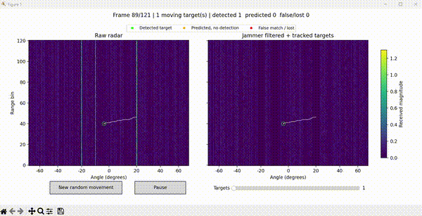
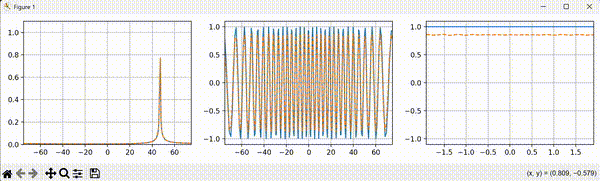
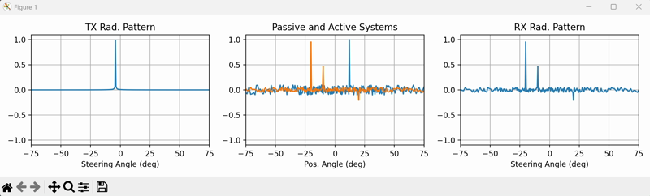
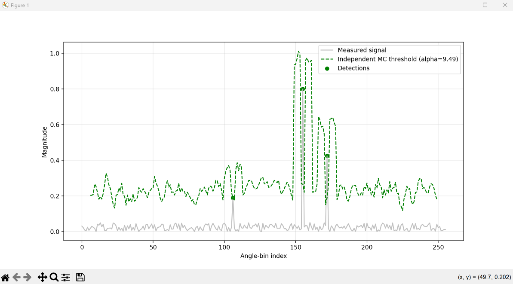
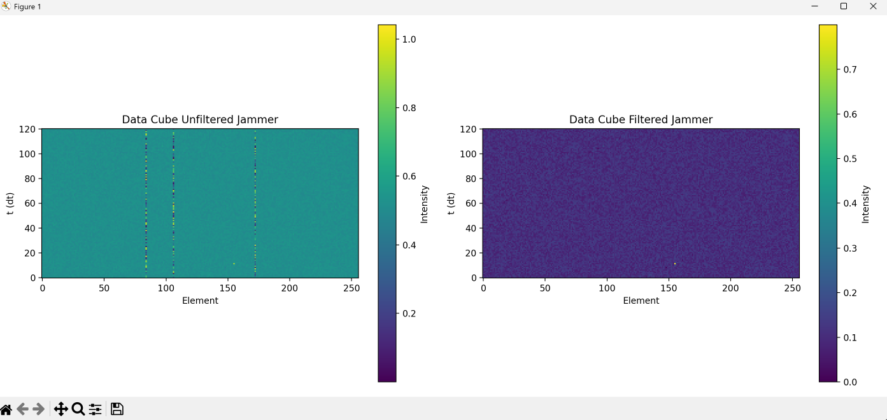

# Simulated Phased-Array Radar: Monte Carlo CFAR and Jammer Mitigation

Made by Colden Rother, Owen Cunningham, Thomas Mullenberg

A Python demonstration of beam steering, radar-like data, constant false alarm rate (CFAR) detection, persistent jammer identification, angle-column suppression, and moving-target tracking. The default program is an interactive **range–angle** simulation. Two earlier experiments in the same folder show the phased-array beam model and an animated **scan-angle–by–angle** view.

> **Simulation, not a hardware radar.** Values are normalized, range is measured in bins rather than meters, and the default demo suppresses detected angle columns in software. It does not synthesize physical antenna null weights, model a radar waveform, or measure Doppler.

[](Photos_videos/Target_sim.mp4)

*The full-duration inline animation of the [interactive target simulation](Photos_videos/Target_sim.mp4). The left panel shows the received image; the right panel shows detected jammer directions removed and the target track. Click the image or link for the full video.*

## Quick start

Requirements: Python 3.9 or newer, NumPy, Matplotlib, and a desktop environment with an interactive Matplotlib window.

```bash
python -m pip install numpy matplotlib
python main.py
```

Run commands **from this folder**; the programs use relative `sim_data/` paths. Startup calibrates CFAR on independent simulated background cubes before opening the plot, so the first window can take a little time to appear. Each run creates new target paths and noise. The calibration random seed is fixed at `2026`, while the displayed motion uses a fresh random generator.

| Control | Action |
| --- | --- |
| **New random movement** | Generate new paths and noise with the current target count; reuse the calibrated threshold multiplier. |
| **Pause / Play** | Freeze or resume the animation. |
| **Targets** | Choose 0–100 targets. Release the slider to generate a new sequence. Zero shows the jammer and noise background. |

The default is one moving target. The animation cycles through 121 simulated frames. At high target counts, targets can overlap or merge into one detected cell, and the simple tracker can swap identities. White trails are drawn only for 10 or fewer targets.

### Other entry points

```bash
python live_sim.py       # older moving-target scan-angle experiment
python main_static.py    # original static jammer and aperture experiment
```

`main_static.py` writes several `.npy` files and needs a `sim_data/` directory. If the folder is absent in a fresh checkout, create it first (`mkdir sim_data`). Run `main_static.py` before the standalone `graph_*.py`, `jammer_detect.py`, or `monte_carlo.py` scripts, which read its saved output. `live_sim.py` creates `sim_data/` itself. For a clean GitHub release, the generated `.npy` files are examples of outputs, not prerequisites for the default `main.py` run.

## What the main graph shows

The default window displays the same frame twice with a shared, fixed color scale: brighter colors mean greater **received magnitude**. The horizontal axis is **angle**, labeled in degrees through FFT angle-bin ticks. The vertical axis is a **simulated range bin** (`0`–`120`), not physical distance. One frame is a `121 × 256` range–angle image; the full data cube has shape **`(121 frames, 121 range bins, 256 angle bins)`**.

| View or mark | Meaning |
| --- | --- |
| **Raw radar (left)** | Background noise and clutter, moving target returns, and three fixed jammer directions. Persistent bright vertical stripes are jammers because they occupy an angle through many range bins and frames. |
| **Jammer filtered + tracked targets (right)** | The same image after setting detected jammer angle bins, plus five neighboring bins on each side, to zero. The dark vertical bands are intentional blind regions. A real target in a band is removed too. |
| **Green dot** | A CFAR measurement was associated with a track and is within 1.5 plotted bins of a simulated target. Ground truth is used to *color/evaluate* the dot, not to position it. |
| **Orange dot** | No accepted measurement; the tracker is coasting on its estimated velocity for up to 12 frames. |
| **Red dot** | A measurement did not match a simulated target, or a track has been lost after the prediction limit. |
| **White line** | Recent estimated track positions. A dashed segment indicates a predicted position. |

The title reports frame number, chosen target count, and counts by track status. Both panels show the same track overlay so a measured or predicted position can be compared before and after filtering. The color bar is fixed at `0`–`1.3` for the default interactive view, making suppression visually comparable across frames.

### Illustrations and recordings

| Media | What to look for |
| --- | --- |
| [Full target simulation video](Photos_videos/Target_sim.mp4) | Moving target, persistent jammer stripes, null bands, tracking dots, and controls. The GIF above covers the entire recording at a reduced frame rate. |
| [Older window/array sweep video](Photos_videos/initial_randomized_sweep.mp4) | Three plots of radiation magnitude, complex aperture/array response, and the recovered window as the scan advances. Full-duration inline animation below. |
| [Steered-array scan clip](Photos_videos/Graph_sim_steered_array_sweep.mp4) | Transmit beam, passive/active scene, and received pattern. The supplied MP4 has one frame; the still below shows its content. |
| [Project presentation (PDF)](Presentation/Montecarlo%20Jammer%20Nulling.pdf) | Original project motivation and static-demo diagrams. Some detection rules and cube descriptions predate this code. |

[](Photos_videos/initial_randomized_sweep.mp4)

[](Photos_videos/Graph_sim_steered_array_sweep.mp4)

GitHub displays the full-duration GIF animations directly at a reduced frame rate; clicking them opens the original MP4 files at their original quality. GitHub's README renderer does not reliably embed an MP4 player, so the full recordings are linked as repository files. GitHub warns that `Target_sim.mp4` exceeds its recommended 50 MB size; the full video is included in this repository.

## How the simulation works

### 1. Array and scene assumptions

The array experiment in `config.py`, `functions.py`, `sim.py`, and `live_sim.py` assumes a **uniform linear array** of `N = 256` ideal elements, operating at `f₀ = 10 GHz`, with element spacing `d = λ₀/2` and steering directions from `−60°` to `+60°` in one-degree steps. Free-space speed is calculated from `ε₀` and `μ₀`, and `λ₀ = c₀/f₀` (approximately 3 cm). The idealized aperture is rectangular. For element position `xₙ` and steering angle `θₛ`, the code uses a phase ramp

```math
w_n(\theta_s)=\exp\!\left(j\frac{2\pi}{\lambda_0}x_n\sin\theta_s\right),
\qquad
B_{\theta_s}[k]\propto\operatorname{FFTshift}\{\operatorname{FFT}_n(w_n)\}[k].
```

The FFT maps the array aperture to an idealized angular radiation pattern. The normalization makes the largest modeled response unity. This is a far-field, narrowband, scalar model: it omits element patterns, mutual coupling, calibration errors, propagation loss, multipath, polarization, receiver saturation, and real transmit/receive hardware.

The **default interactive** simulation reuses the 256-bin angular grid but sets background beam gain to one. It does **not** recalculate a steered array response for each range cell. Three jammers are placed near `−20°`, `−10°`, and `+20°`; they remain fixed in angle while their amplitudes vary. Target positions begin away from those angles. Each target receives an independent initial position, heading, and speed (0.9–2.1 plotted units per frame), moves in angle and range, and reflects at the display boundaries. A target contributes `1.2` to one rounded range/angle cell. Jammer contributions are uniformly sampled from `0.65` to `1.0` in their angle columns. Background clutter is uniform in `[-0.1, 0.1]` by angle for a frame; receiver noise is independent uniform `[-0.05, 0.05]` per cell. The displayed image uses absolute magnitude.

These amplitudes and speeds are **display units**, not calibrated radar cross section, received power, velocity, or SNR. No pulse compression, time-of-flight calculation, Doppler processing, or probability-of-detection claim is made.

### 2. Monte Carlo calibrated CA-CFAR

For every eligible cell under test (CUT) at angle-bin index `i`, the program estimates local background from **10 training cells** (five on each side) and excludes **two guard cells** (one on each side) plus the CUT. The first and last six angle bins have no full window and are not tested. With magnitude `z_i`, training set `T_i`, and `N_T=10`:

```math
\widehat{\mu}_i=\frac{1}{N_T}\sum_{j\in T_i} z_j,
\qquad
\gamma_i=\alpha_{\mathrm{MC}}\widehat{\mu}_i,
\qquad
\text{detect at }i\iff z_i>\gamma_i.
```

The multiplier `α_MC` is fitted **once** from target-free, jammer-free Monte Carlo backgrounds that match the simulation's clutter and receiver-noise distributions. For each calibration cell, the code computes the ratio `r = z_i / μ̂_i`; it collects ratios from **1,000** independent cubes and selects the upper empirical quantile:

```math
\alpha_{\mathrm{MC}}=Q^{\mathrm{higher}}_{1-P_{\mathrm{FA,target}}}
\left(\left\{\frac{z_i}{\widehat{\mu}_i}\right\}_{\mathrm{noise\ only}}\right),
\qquad P_{\mathrm{FA,target}}=10^{-6}.
```

Here `higher` means the first sampled ratio at or above the requested quantile. The desired false-alarm probability applies **per tested cell**, not per frame, target, or jammer column. Another **500 fresh cubes** measure the resulting cell false-alarm rate and the false jammer-column rate; these validation cubes are not used to choose `α_MC`. The fixed calibration seed makes the fitted multiplier reproducible. It is an **empirical** threshold for this noise model, not a universal analytic CA-CFAR multiplier. An example screenshot may show a different value because it was generated from an earlier run.



*Example CFAR row: gray is measured magnitude, green dashed is `α_MC ×` the local training-cell average, and green dots are cells exceeding that threshold. X is an angle-bin **index**, not an antenna element.*

### 3. Jammer identification and filtering

CFAR hits are computed along the angle axis for each range row (or scan row in the older experiments). A column is a jammer candidate in a frame if it contains **at least five consecutive CFAR hits** down that row axis. The current moving demos then require that column to qualify in **at least 60% of frames**. This exploits the simulated jammers' fixed directions and broad row coverage; a moving target is less persistent. The criterion uses magnitudes and positive hit comparisons. The presentation's older “negative-intensity” condition is **not** used by the current code.

In `main.py`, filtering zeros each detected center column and five bins on either side in **every frame and range row**. This is software masking of the data cube, not adaptive RF beamforming. It can erase a target at a jammer angle and leave a blind band; errors in detection can also mask useful data. The older `live_sim.py` zeros only detected center columns. The static experiment additionally masks its calculated radiation pattern and applies an inverse FFT to illustrate a possible aperture/window response. That inverse transform is an idealized design visualization, not a validated set of physical antenna weights.



*The original static experiment: persistent bright columns on the left are suppressed on the right. Its horizontal label says “Element,” but the image columns are angular FFT bins; its vertical axis is a scan/time index, not range. The panels use separate color bars, so compare the removed stripes rather than absolute color across panels.*

### 4. Moving-target detections and tracks

After masking, the interactive demo runs 2D candidate selection over the range–angle frame. Each range row receives the same angle-axis CFAR calculation, plus a minimum measured magnitude of `0.20`. The tracker initializes from the strongest measured candidates, up to the chosen target count. In later frames it predicts each position using an estimated two-dimensional velocity, associates the nearest unused detection inside a distance gate, and blends predicted and observed velocity. Without a detection, it predicts for at most 12 frames and reflects predictions at known display edges. Lost tracks may reacquire an unmatched measured point. The simulated target coordinates are used only to score whether a displayed detection is correct; they do not supply the tracker position or fill missing measurements.

This is a simple nearest-neighbor tracker. Crossing targets, close targets, false hits, turns inside a blind region, and long gaps can cause missed detections, drift, or identity switches. There is no Kalman filter.

## Code and generated data

| File | Role |
| --- | --- |
| `main.py`, `interactive_sim.py` | Default interactive range–angle simulation, widgets, CFAR detections, and tracks. |
| `monte_carlo.py` | Background generation, empirical CFAR calibration and validation, local noise estimates. |
| `live_sim.py` | Earlier moving target through a steered scan, persistent jammer search, and raw/filtered animation. |
| `main_static.py`, `sim.py`, `jammer_detect.py`, `nullification.py` | Original static scan: synthesize data, detect jammer columns, mask data, and show idealized inverse-FFT recovery. |
| `config.py`, `functions.py`, `formulas.py` | Shared physical constants, beam steering, simple signals, FFT, and plotting helpers. |
| `graph_*.py` | Standalone plots of saved outputs from the static experiment. |

The default run overwrites `sim_data/interactive_cube_raw.npy` and `interactive_cube_clean.npy` (both frame × range × angle), `interactive_target_angles.npy`, `interactive_target_ranges.npy` (both frame × target), and `interactive_jammer_bins.npy` (detected center indices). It also saves `interactive_background_gain.npy`, the unit-gain calibration input. The `live_*` and unprefixed files belong to the older experiments. These `.npy` files are convenient for inspection with `numpy.load`; they are regenerated by their entry points.

## Scope and interpretation

The project demonstrates how a simulated fixed-direction jammer can be distinguished from moving targets by **local CFAR detections plus persistence**, then shows the benefit and cost of suppressing that direction. The default range axis and time steps are synthetic, so the graphs should be read as a signal-processing illustration. The presentation records the project history; for current behavior and thresholds, this README and the Python source are authoritative.
